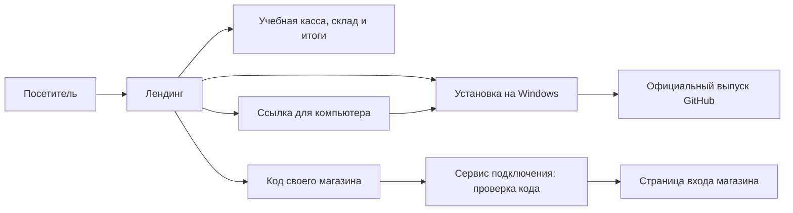

# Архитектура и логика сайта — 25 октября 2026

## Пути посетителя

| Кто пришёл                             | Основной путь                                                               | Результат                                                                           |
| -------------------------------------- | --------------------------------------------------------------------------- | ----------------------------------------------------------------------------------- |
| Хочет проверить продукт в браузере     | Херо или меню → демо; карточка возможностей → касса / склад / итоги         | Учебный магазин без регистрации, реальные данные магазина не используются           |
| Новый клиент с Windows                 | Возможности → экраны → проба и лицензия → скачать → первый приход и продажа | Проверенный установщик официального стабильного выпуска                             |
| Новый клиент с телефона, Mac или Linux | «Получить для Windows» → ссылка для компьютера → скопировать или поделиться | Продолжение установки на Windows; EXE на неподдерживаемом устройстве не скачивается |
| Действующий магазин                    | «Войти в магазин» → код или полный адрес → проверка                         | Страница входа своего магазина; PIN и пароль вводятся уже там                       |

Обновление предложения, прямой ссылки `#installation`, выбора платформы до первого кадра и масштабирования экранов описано в [offer-install-preview-v33.md](offer-install-preview-v33.md).

Лендинг остаётся статическим. Сайт не хранит данные магазина, не принимает платежи и не проверяет PIN или пароль. Эти функции принадлежат приложению и его терминалу. Стоимость не выдумана: обращение ведёт в поддержку, рядом указаны 14 дней пробы и условия лицензии.

## Технические границы

`app.js` сразу запускает независимые визуальные модули и параллельно загружает общие правила. Только скачивание и вход ждут `core.js`; отказ этого файла не отключает меню, высоту экранов, демонстрации и просмотр. Ошибка загрузки или исполнения визуального модуля не останавливает вход и получение установщика. Блок, который не удалось включить, оставляет статическую версию или понятное пояснение.

Настройки адресов, проверка магазина и выбор установщика живут в `scripts/core.js`. Функции интерфейса получают эти зависимости явно. Параметр версии загрузчика передаётся всем браузерным модулям, чтобы после публикации не смешивались старые и новые версии файлов. В браузере не требуются фреймворк, сборщик или сервер приложения. CSS готовится заранее через `npm run build:styles`: одна таблица на страницу, имя по содержимому, автоматические ссылки и сохранение предыдущего файла для кэшированного HTML. `npm run check:styles` в CI проверяет соответствие исходникам.

### Скачивание и устройство

До запуска модулей основные CTA ведут в `#installation`; официальный выпуск доступен из самого блока. После определения Windows ссылки становятся прямыми. Из ответа GitHub принимается только ожидаемый стабильный выпуск и конкретный файл `SmartStore-Setup-<версия>-x64.exe` с точным URL официального репозитория. При ошибке остаётся исходная ссылка на страницу выпуска.

На других устройствах все кнопки установки ведут к одному блоку продолжения на компьютере, без запроса Windows-релиза к GitHub API. Поздний ответ GitHub не заменяет их ссылкой на EXE. Копирование подтверждается только после успеха; при запрете буфера адрес выделяется для ручного копирования. Системный выбор способа отправки доступен только по нажатию посетителя и при поддержке браузером.

### Вход по коду

`idle → checking → redirecting / not-found / unavailable`; неправильный ввод даёт `invalid`. Редактирование поля отменяет текущий запрос и возвращает `idle`. Каждый запрос имеет номер: устаревший ответ не может изменить подсказку или открыть прежний магазин. Новый submit отменяет предыдущую проверку до валидации нового значения.

Разрешён один код из 2–40 латинских букв, цифр и дефисов либо HTTPS-адрес соответствующего поддомена metov.store. Чужие домены, вложенные поддомены, учётные данные, нестандартные порты и служебные коды отклоняются. Адрес перехода строится локально из проверенного кода; URL из ответа сервера не используется.

Если магазин не найден, пользователь исправляет код. Если сервис не отвечает или возвращает некорректный JSON, предлагается явная ссылка прямого перехода. Редактирование поля удаляет эту старую ссылку. Таймаут охватывает и получение заголовков, и чтение JSON.

### Просмотр и статический режим

Увеличение показывает исходный экран, состояние загрузки и ссылку на оригинал при ошибке. Ctrl/Cmd/Shift-нажатие сохраняет обычное поведение ссылки. Ссылка на конкретный вопрос FAQ раскрывает ответ. Без JavaScript доступны навигация, FAQ, изображения и официальная страница скачивания; форма, которую нельзя обработать, отключена и сопровождается инструкцией про QR-код.

## Проверка

- Шесть Node-тестов: нормализация и границы адресов, проверка установщика, неуспешные ответы, некорректный JSON, отмена и таймаут включая тело ответа.
- Chromium: Windows и мобильный сценарий, копирование и отказ буфера, недоступный API релизов, ошибочный/отсутствующий магазин, некорректный ответ, устаревший запрос, переход только на построенный адрес магазина.
- Отдельно проверены отказ загрузки модуля галереи и ошибка её исполнения: вход и скачивание продолжают работать.
- Проверены ошибка изображения с резервной ссылкой, переключение оригинальных экранов, глубокая ссылка FAQ, меню, 320–1440 px и режим без JavaScript.
- GitHub Actions выполняет доменные тесты и проверку синтаксиса модулей. Отдельные автоматические проверки WebKit покрывают первый кадр, высоту под панелью, жесты, поворот, установку и просмотр. Физический iPhone в среде недоступен.

Текущая загрузка, источники CSS, размеры файлов и проверки отказов описаны в [runtime-loading-v34.md](runtime-loading-v34.md).

## Отдельный демомагазин

`/demo/` доступен из херо без регистрации. Касса, склад и отчёт работают с одним учебным состоянием. Чистая модель `demo/model.js` считает в целых тиынах, проверяет количество и остатки, проводит продажу целиком и пересчитывает итоговые данные. При восстановлении сохранённые операции проигрываются заново; вычисленным суммам и остаткам из браузерного хранилища доверия нет.

Обычные ссылки в меню и трёх карточках возможностей позволяют открыть демо
из середины страницы: `/demo/#sale`, `/demo/#stock`, `/demo/#reports`.
Нажатие на всю карточку и Enter на ссылке открывают один и тот же экран;
без JavaScript переход остаётся доступен. Эти ссылки не загружают ресурсы
демомагазина до перехода. Подробности: [landing-demo-v36.md](landing-demo-v36.md).

`demo/app.js` отвечает за поиск, фильтры, окна оплаты/чека, маршруты `#sale`, `#stock`, `#reports`, доступность и сохранение в отдельном ключе sessionStorage. Вкладки независимы. При отказе хранилища можно работать в памяти, при повреждении — восстановить исходный демомагазин. Приложение не делает API-запросов и не подключается к рабочему магазину или платёжному сервису.

Сборка демо создаёт отдельные JS и CSS с хешами и сохраняет предыдущую версию для кэшированного HTML. Лендинг содержит обычную ссылку; его модули и CSS не импортируют демо. Ссылка «Установить» возвращает посетителя в проверенный `#installation`. Поведение и расчёты: [live-demo-v35.md](live-demo-v35.md).
